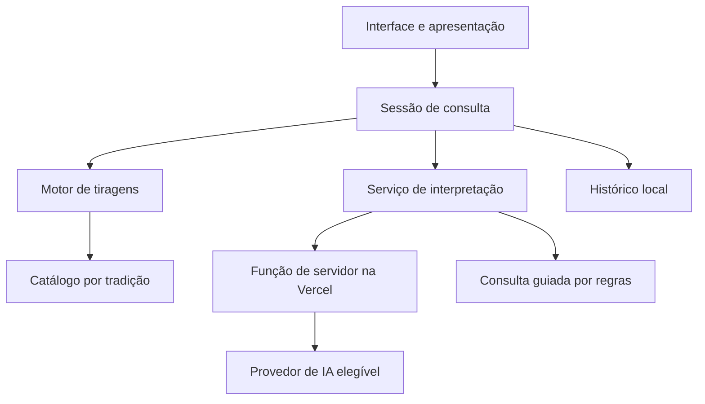

<p align="center"></p>

# Velumbra

Aplicação web interativa de cartomancia, planejada como um monólito modular full stack com interface animada, catálogo de quatro tradições, motor de tiragens e interpretação contextual opcional por IA.

O nome reúne véu, vela e *umbra* (sombra). A apresentação da experiência, ambientação, personagem e mecânicas está em [GAME.md](GAME.md).

---

## Estado e escopo do repositório

**Fase: prólogo funcional anterior à sprint 1.** Já existem abertura animada, cenário interativo, menu, identificação local, prévias dos quatro baralhos e ajustes de som e movimento. O motor de tiragens, o catálogo completo, a personagem animada em camadas e a IA continuam planejados. Todas as 20 sprints permanecem pendentes.

O prólogo é uma aplicação estática em HTML, CSS e JavaScript, com build sem dependências externas. A velha aparece como entidade no cenário, com movimento sutil e cochichos preparados. O menu usa objetos desenhados e superfícies de papel e tecido. Essa entrega valida a identidade e a navegação antes da fundação em Next.js. Escopo e verificações estão em [docs/PROLOGUE.md](docs/PROLOGUE.md).

**[Abrir o prólogo publicado na Vercel](https://velumbra-hazel.vercel.app/)**

O desenvolvimento está organizado em **20 sprints**: testes e mudanças nas sprints **18 e 20**, MVP integrado na sprint **19**. O acompanhamento fica em Markdown no próprio repositório, sem Issues ou GitHub Projects.

---

## Objetivos técnicos

| Objetivo | Abordagem planejada |
| --- | --- |
| Um único deploy | Interface, recursos e função de interpretação na Vercel. |
| Quatro tradições independentes | Catálogo e regras próprios para Rider–Waite–Smith, Marselha, Thoth e Petit Lenormand. |
| Leitura contextual | Combinar pergunta, intenção, tradição, posições, orientação e relações entre cartas. |
| Experiência resiliente | Oferecer consultas guiadas quando a IA estiver indisponível. |
| Custo inicial zero | Operar dentro das cotas gratuitas, sem cobrança ou recarga automática. |
| Persistência simples | Histórico no navegador, sem conta obrigatória ou banco inicial. |
| Qualidade visual | Recursos originais, animações controladas e interface responsiva. |

---

## Stack planejada

| Camada | Tecnologia ou decisão |
| --- | --- |
| Aplicação | Next.js e TypeScript; versões serão fixadas na sprint 1. |
| Renderização | Cena em perspectiva e personagem em camadas; técnica validada nas sprints 2 e 3. |
| Conteúdo | Dados editoriais versionados e recursos estáticos. |
| Backend | Função de servidor da aplicação, hospedada na Vercel. |
| IA | Avaliar Vercel AI Gateway gratuito; Groq Free como alternativa de integração. |
| Histórico | Armazenamento local no navegador, com validação e versão do esquema. |
| Publicação | Vercel, respeitando as condições do plano e limites de uso. |

---

## Arquitetura



A interface apresenta os resultados e controla animações. O domínio define sorteio e tiragens. A interpretação recebe os dados de domínio e a pergunta. O provedor de IA fica isolado atrás da função de servidor, permitindo trocar a integração sem reescrever a interface.

---

## Módulos e responsabilidades

| Módulo | Responsabilidade |
| --- | --- |
| Catálogo | Cartas, identidade, ordem, nomes, símbolos, fontes e arquivos de arte. |
| Tiragens | Definição de posições, sorteio sem reposição e política de inversões. |
| Consulta | Pergunta, tema, intenção, cartas e estado da jornada. |
| Interpretação | Contexto editorial, chamada opcional de IA, validação e reserva guiada. |
| Personagem | Diálogo, expressões, gestos e sincronização com as cartas. |
| Biblioteca | Inspeção completa, ampliação e descrição das cartas. |
| Diário | Persistência local, versão de esquema e recuperação de consultas. |
| Preferências | Áudio, velocidade do texto, tratamento e redução de movimento. |

---

## Modelo de conteúdo

| Entidade | Dados principais |
| --- | --- |
| Baralho | Identificador de tradição, nome, quantidade, ordem e regras. |
| Carta | ID estável, nome, número, naipe/corte quando aplicável, símbolos, descrição, arte e fonte editorial. |
| Tiragem | Identificador, posições nomeadas e quantidade de cartas. |
| Consulta | Baralho, pergunta, intenção, cartas, posições, orientação e data. |
| Leitura | Explicações por carta, conexões, veredito, modalidade e versão editorial. |

São **270 registros**: três catálogos de 78 cartas e um de 36. A equivalência entre cartas de tradições diferentes deve ser explícita; os sistemas não compartilham automaticamente os mesmos significados ou numeração.

---

## Fluxo de interpretação

| Etapa | Comportamento planejado |
| --- | --- |
| Entrada | Validar pergunta, tradição, tiragem e tamanho dos dados. |
| Sorteio | Selecionar cartas sem reposição, independentemente da pergunta. |
| Contexto | Reunir apenas conteúdo relevante às cartas e posições selecionadas. |
| Geração | Uma chamada retorna explicações e veredito da consulta completa. |
| Validação | Conferir formato, IDs, posições e presença das partes esperadas. |
| Apresentação | Revelar e apresentar o conteúdo progressivamente com a personagem. |
| Indisponibilidade | Oferecer consulta guiada; informar quando perguntas livres dependem de IA. |

Checagens de estrutura não asseguram qualidade semântica. Consultas de referência serão revisadas para verificar pertinência, contradições e coerência do veredito.

---

## Contrato de API proposto

A sprint 6 definirá a rota e os tipos finais. Ainda não existe endpoint implementado.

| Operação | Entrada | Saída |
| --- | --- | --- |
| Interpretar consulta | Tradição, pergunta, tiragem, IDs e orientação das cartas. | Falas por posição, conexões e veredito estruturado. |
| Tratar falha | Timeout, limite do provedor ou resposta inválida. | Estado de indisponibilidade ou oferta de modalidade guiada. |

As descrições editoriais serão resolvidas no servidor pelos IDs recebidos. O navegador não deve escolher prompts de sistema nem expor credenciais.

---

## Segurança e privacidade

| Área | Decisão planejada |
| --- | --- |
| Credenciais | Variáveis de ambiente exclusivas do servidor; nunca publicar chaves. |
| Requisições | Validar tamanho, formato, IDs de cartas e combinações permitidas. |
| Abuso e cotas | Limites de frequência, duração e saída aplicados no servidor. |
| Texto gerado | Renderizar como texto seguro; não executar HTML retornado pelo modelo. |
| Perguntas pessoais | Evitar registro do conteúdo em logs; documentar envio ao provedor quando houver IA. |
| Histórico | Permanecer no dispositivo nesta versão; sem sincronização prometida. |
| Custos | Sem recarga automática, contratação ou fallback pago. |

---

## Desenvolvimento local

Pré-requisito do prólogo: Node.js 22 ou superior. A execução foi verificada com Node.js 24.19.0. Não é necessário instalar pacotes ou configurar credenciais.

```sh
npm run dev
```

Abra `http://127.0.0.1:4173`. Para gerar os arquivos estáticos de publicação:

```sh
npm run build
```

O resultado fica em `dist/`. `vercel.json` configura o build e a pasta de saída. A aplicação completa em Next.js será estruturada na sprint 1; o prólogo não antecipa a conclusão dessa sprint.

---

## Deploy e operação

A Vercel é o destino previsto para a aplicação e a função de backend. Arte e animações serão preparadas previamente; não haverá geração de imagens ou vídeos a cada consulta.

O plano Hobby é destinado a uso pessoal e não comercial. Cotas de hospedagem e IA devem ser confirmadas durante a integração. A disponibilização gratuita inicial não representa capacidade ilimitada. Monetização exige reavaliar plano e termos.

O prólogo pode ser publicado como aplicação estática, sem variáveis de ambiente ou funções de servidor. Credenciais e integração de IA serão configuradas nas etapas correspondentes. Nenhum serviço pago é necessário para esta abertura.

---

## Validação e testes

| Área | Verificações previstas |
| --- | --- |
| Domínio | Contagens, IDs únicos, ordem, cortes e regras por tradição. |
| Tiragens | Quantidade, ausência de repetição e orientação permitida. |
| Interpretação | Contexto em temas distintos, mesmas cartas em perguntas diferentes e veredito coerente. |
| Resiliência | Timeout, cota esgotada, resposta inválida e modalidade guiada. |
| Interface | Navegação, biblioteca, histórico, teclado e telas móveis. |
| Arte e movimento | Legibilidade, consistência, transições e redução de movimento. |
| Publicação | Build, variáveis de ambiente e jornada completa no ambiente publicado. |

Cada sprint inclui verificação proporcional. As sprints 18 e 20 concentram revisão integrada e correções.

---

## Documentação

| Arquivo | Conteúdo |
| --- | --- |
| [GAME.md](GAME.md) | Experiência, ambientação, personagem e escopo do jogo. |
| [docs/SPRINTS.md](docs/SPRINTS.md) | Plano de execução das 20 sprints e critérios de conclusão. |
| [docs/ARCHITECTURE.md](docs/ARCHITECTURE.md) | Decisões de implementação e dependências externas. |
| [docs/ART_DIRECTION.md](docs/ART_DIRECTION.md) | Direção visual e estados animados. |
| [docs/ASSETS.md](docs/ASSETS.md) | Ícone inicial, origem e instrução de geração. |
| [docs/RESEARCH.md](docs/RESEARCH.md) | Pesquisas recuperadas, fontes e limites da verificação. |
| [docs/PROLOGUE.md](docs/PROLOGUE.md) | Implementação e validação da abertura anterior à sprint 1. |

---

## Referências técnicas

| Fonte | Uso |
| --- | --- |
| [Vercel Hobby](https://vercel.com/docs/plans/hobby) | Elegibilidade e cotas de hospedagem. |
| [Vercel AI Gateway](https://vercel.com/docs/ai-gateway/pricing) | Modelos elegíveis, créditos e limites. |
| [Groq](https://console.groq.com/docs/rate-limits) | Alternativa de integração e limites. |

---

## Estrutura atual

```text
GAME.md                  Experiência e regras previstas
docs/                    Arquitetura, arte, pesquisa e sprints
public/brand/            Ícone original recuperado
public/art/              Cenário original da cabana
public/audio/            Cochichos preparados em português
public/fonts/            Fontes locais e respectivas licenças
src/                     Interface e comportamento do prólogo
scripts/                 Servidor local e build estático
index.html               Entrada da abertura
vercel.json              Configuração de publicação estática
```

## Autoria e contribuição

Projeto de [Pedro Henrique Silva Vargas](https://github.com/PHnsilva). O ícone inicial foi gerado com a ferramenta integrada de imagens do ChatGPT; sua origem está registrada em [docs/ASSETS.md](docs/ASSETS.md).

O planejamento é mantido nos documentos deste repositório. Contribuições devem descrever o objetivo da mudança e as verificações realizadas. Não criar Issues ou GitHub Projects neste ciclo, conforme a organização definida para o projeto.

## Licença

Ainda não foi escolhida uma licença para distribuição e reutilização do projeto. Nenhuma licença de código aberto é declarada para o conjunto nesta etapa. Cormorant Garamond e IBM Plex Mono têm licenças SIL OFL próprias, preservadas em `public/fonts/`.
