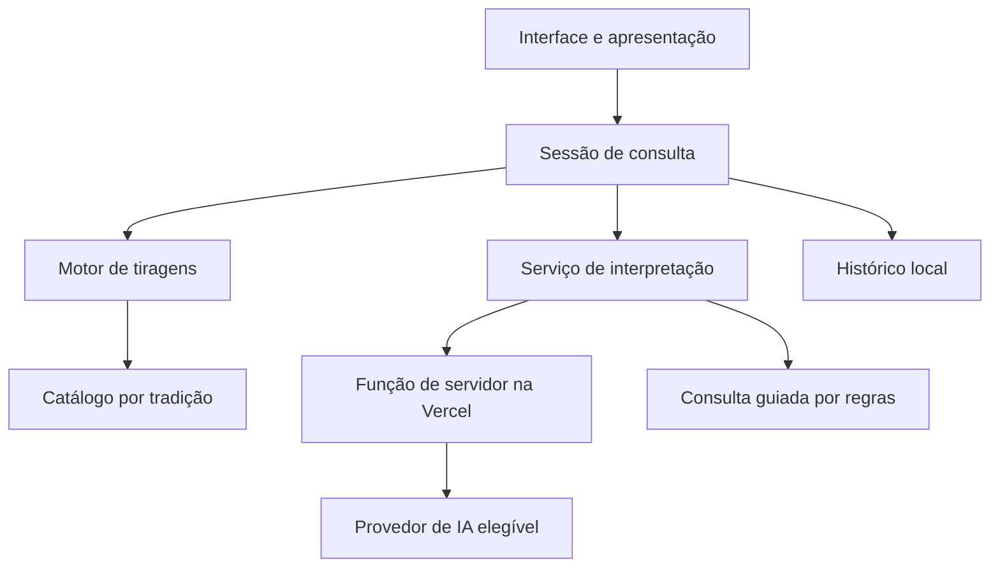

# Velumbra

Velumbra é uma experiência interativa de cartomancia ambientada em uma cabana de horror. O jogador escolhe uma tradição, faz uma tiragem, recebe uma leitura contextual e pode guardar a consulta no diário local. A experiência prevê quatro tradições e 270 cartas, uma personagem animada e interpretações guiadas de reserva.

O nome reúne véu, vela e _umbra_ (sombra). A ambientação e as mecânicas estão em [GAME.md](GAME.md). Requisitos, arquitetura, plano de entregas e rastreabilidade estão documentados em [REQUIREMENTS.md](docs/REQUIREMENTS.md), [ARCHITECTURE_PLAN.md](docs/ARCHITECTURE_PLAN.md), [DELIVERY_PLAN.md](docs/DELIVERY_PLAN.md) e [TRACEABILITY.md](docs/TRACEABILITY.md). A política de contribuição está em [CONTRIBUTION_POLICY.md](docs/CONTRIBUTION_POLICY.md); os registros de implementação e validação estão em [PROGRESS.md](docs/PROGRESS.md).

**[Abrir a experiência publicada](https://velumbra-hazel.vercel.app/)**

## Implementação e estado

O repositório contém uma aplicação Next.js com TypeScript e módulos de compatibilidade para o prólogo. O estado de implementação, validações, limitações e decisões pendentes é mantido em [docs/PROGRESS.md](docs/PROGRESS.md). O plano de entregas descreve o escopo pretendido e não comprova, por si só, implementação ou aceite.

O desenvolvimento do produto está organizado em cinco sprints de entrega e uma sprint de validação extra e mudanças. As vinte entregas históricas e seu mapeamento estão em [docs/SPRINTS.md](docs/SPRINTS.md) e [docs/HISTORICAL_20_SPRINTS.md](docs/HISTORICAL_20_SPRINTS.md). O estado vivo das entregas está no [Project #7](https://github.com/users/PHnsilva/projects/7/views/1) e nas [issues do repositório](https://github.com/PHnsilva/velumbra/issues).

---

## Objetivos técnicos

| Objetivo                       | Abordagem planejada                                                                   |
| ------------------------------ | ------------------------------------------------------------------------------------- |
| Um único deploy                | Interface, recursos e função de interpretação na Vercel.                              |
| Quatro tradições independentes | Catálogo e regras próprios para Rider–Waite–Smith, Marselha, Thoth e Petit Lenormand. |
| Leitura contextual             | Combinar pergunta, intenção, tradição, posições, orientação e relações entre cartas.  |
| Experiência resiliente         | Oferecer consultas guiadas quando a IA estiver indisponível.                          |
| Custo inicial zero             | Operar dentro das cotas gratuitas, sem cobrança ou recarga automática.                |
| Persistência simples           | Histórico no navegador, sem conta obrigatória ou banco inicial.                       |
| Qualidade visual               | Recursos originais, animações controladas e interface responsiva.                     |

---

## Stack planejada

| Camada       | Tecnologia ou decisão                                                                              |
| ------------ | -------------------------------------------------------------------------------------------------- |
| Aplicação    | Next.js 16.4.3, React 19.3.1 e TypeScript 7.0.2, fixados no lockfile.
| Renderização | Cena em perspectiva e personagem em camadas; técnica validada nas sprints 2 e 3.                   |
| Conteúdo     | Dados editoriais versionados e recursos estáticos.                                                 |
| Backend      | Função de servidor da aplicação, hospedada na Vercel.                                              |
| IA           | Interpretação opcional no servidor; o provedor depende de contrato, disponibilidade e custo verificados.                      |
| Histórico    | Armazenamento local no navegador, com validação e versão do esquema.                               |
| Publicação   | Vercel, respeitando as condições do plano e limites de uso.                                        |

---

## Arquitetura



A interface apresenta os resultados e controla animações. O domínio define sorteio e tiragens. A interpretação recebe os dados de domínio e a pergunta. O provedor de IA fica isolado atrás da função de servidor, permitindo trocar a integração sem reescrever a interface.

---

## Módulos e responsabilidades

| Módulo        | Responsabilidade                                                        |
| ------------- | ----------------------------------------------------------------------- |
| Catálogo      | Cartas, identidade, ordem, nomes, símbolos, fontes e arquivos de arte.  |
| Tiragens      | Definição de posições, sorteio sem reposição e política de inversões.   |
| Consulta      | Pergunta, tema, intenção, cartas e estado da jornada.                   |
| Interpretação | Contexto editorial, chamada opcional de IA, validação e reserva guiada. |
| Personagem    | Diálogo, expressões, gestos e sincronização com as cartas.              |
| Biblioteca    | Inspeção completa, ampliação e descrição das cartas.                    |
| Diário        | Persistência local, versão de esquema e recuperação de consultas.       |
| Preferências  | Áudio, velocidade do texto, tratamento e redução de movimento.          |

---

## Modelo de conteúdo

| Entidade | Dados principais                                                                                     |
| -------- | ---------------------------------------------------------------------------------------------------- |
| Baralho  | Identificador de tradição, nome, quantidade, ordem e regras.                                         |
| Carta    | ID estável, nome, número, naipe/corte quando aplicável, símbolos, descrição, arte e fonte editorial. |
| Tiragem  | Identificador, posições nomeadas e quantidade de cartas.                                             |
| Consulta | Baralho, pergunta, intenção, cartas, posições, orientação e data.                                    |
| Leitura  | Explicações por carta, conexões, veredito, modalidade e versão editorial.                            |

O escopo previsto é de **270 cartas**: três catálogos de 78 cartas e um de 36. Cada tradição mantém identidade, numeração, símbolos e regras próprios. A equivalência entre cartas de tradições diferentes é explícita; os sistemas não compartilham automaticamente os mesmos significados ou numeração. O estado do catálogo está registrado em PROGRESS.md e nas issues editoriais.

---

## Fluxo de interpretação

| Etapa             | Comportamento planejado                                                    |
| ----------------- | -------------------------------------------------------------------------- |
| Entrada           | Validar pergunta, tradição, tiragem e tamanho dos dados.                   |
| Sorteio           | Selecionar cartas sem reposição, independentemente da pergunta.            |
| Contexto          | Reunir apenas conteúdo relevante às cartas e posições selecionadas.        |
| Geração           | Uma chamada retorna explicações e veredito da consulta completa.           |
| Validação         | Conferir formato, IDs, posições e presença das partes esperadas.           |
| Apresentação      | Revelar e apresentar o conteúdo progressivamente com a personagem.         |
| Indisponibilidade | Oferecer consulta guiada; informar quando perguntas livres dependem de IA. |

Checagens de estrutura não asseguram qualidade semântica. Consultas de referência serão revisadas para verificar pertinência, contradições e coerência do veredito.

---

## Contrato de API proposto

O contrato de API abaixo é uma especificação proposta. O estado de implementação está registrado em PROGRESS.md e nas issues correspondentes.

| Operação             | Entrada                                                   | Saída                                                       |
| -------------------- | --------------------------------------------------------- | ----------------------------------------------------------- |
| Interpretar consulta | Tradição, pergunta, tiragem, IDs e orientação das cartas. | Falas por posição, conexões e veredito estruturado.         |
| Tratar falha         | Timeout, limite do provedor ou resposta inválida.         | Estado de indisponibilidade ou oferta de modalidade guiada. |

As descrições editoriais são resolvidas no servidor pelos IDs recebidos. O navegador não contém prompts de sistema nem credenciais do provedor.

---

## Segurança e privacidade

| Área               | Decisão planejada                                                                   |
| ------------------ | ----------------------------------------------------------------------------------- |
| Credenciais        | Variáveis de ambiente exclusivas do servidor; nunca publicar chaves.                |
| Requisições        | Validar tamanho, formato, IDs de cartas e combinações permitidas.                   |
| Abuso e cotas      | Limites de frequência, duração e saída aplicados no servidor.                       |
| Texto gerado       | Renderizar como texto seguro; não executar HTML retornado pelo modelo.              |
| Perguntas pessoais | Evitar registro do conteúdo em logs; documentar envio ao provedor quando houver IA. |
| Histórico          | Permanecer no dispositivo nesta versão; sem sincronização prometida.                |
| Custos             | Sem recarga automática, contratação ou fallback pago.                               |

---

## Desenvolvimento local

Pré-requisito: Node.js da linha 24, versão 24.15 ou superior. Verificado com 24.19.0. Instale as versões do lockfile; nenhuma credencial é necessária nesta etapa.

```sh
npm ci
npm run dev
```

Abra `http://127.0.0.1:4173`. Para validar a aplicação e servir o build local:

```sh
npm run build
npm run check
npm test
npm start
```

O build fica em `.next/`, servido em `127.0.0.1:4173` por `npm start`. A configuração Vercel usa Next.js, `npm ci` e `npm run build`. Antes do desenvolvimento ou build, o preparador recria somente `public/runtime/`, copia os módulos de compatibilidade e compila o catálogo tipado para JavaScript; essa pasta é gerada, ignorada no Git e não deve ser editada. Os caminhos partem da localização do script, preservando a correção de artefatos obsoletos do PR #1. Arte e fontes são servidas por `/art/`, `/fonts/`, `/audio/` e `/brand/`.

Os testes de DOM agora renderizam o mesmo componente usado pela aplicação, sem um HTML paralelo de teste. Preservam as regressões de identificação do PR #1, verificam a publicação restrita do runtime e iniciam o servidor Next.js para conferir a rota, recursos e respostas HTTP. Esse último teste requer o build prévio. jsdom e tsx são dependências apenas de desenvolvimento. Esses testes não substituem revisão visual, áudio ou animação em navegador real. O workflow executa instalação pelo lockfile, build, tipos, sintaxe e testes.

---

## Deploy e operação

A Vercel é o destino previsto para a aplicação e a função de backend. Arte e animações serão preparadas previamente; não haverá geração de imagens ou vídeos a cada consulta.

Cotas e elegibilidade de hospedagem e IA dependem das condições vigentes dos provedores. A disponibilização gratuita não representa capacidade ilimitada; monetização exige rever os planos e termos aplicáveis.

A aplicação Next.js usa a integração GitHub/Vercel para builds e previews. A função de interpretação e suas credenciais pertencem à fronteira de servidor. O estado de implementação e implantação está em PROGRESS.md; releases dependem dos critérios e da política de contribuição.

---

## Validação e testes

| Área             | Verificações previstas                                                                  |
| ---------------- | --------------------------------------------------------------------------------------- |
| Domínio          | Contagens, IDs únicos, ordem, cortes e regras por tradição.                             |
| Tiragens         | Quantidade, ausência de repetição e orientação permitida.                               |
| Interpretação    | Contexto em temas distintos, mesmas cartas em perguntas diferentes e veredito coerente. |
| Resiliência      | Timeout, cota esgotada, resposta inválida e modalidade guiada.                          |
| Interface        | Navegação, biblioteca, histórico, teclado e telas móveis.                               |
| Arte e movimento | Legibilidade, consistência, transições e redução de movimento.                          |
| Publicação       | Build, variáveis de ambiente e jornada completa no ambiente publicado.                  |

Cada sprint inclui validação proporcional. A sprint S6 complementa a verificação contínua com validação extra e mudanças.

---

## Documentação

| Arquivo                                        | Conteúdo                                                      |
| ---------------------------------------------- | ------------------------------------------------------------- |
| [GAME.md](GAME.md)                             | Experiência, ambientação, personagem e escopo do jogo.        |
| [docs/SPRINTS.md](docs/SPRINTS.md)             | Correspondência entre as 20 entregas históricas e o ciclo atual. |
| [docs/ARCHITECTURE.md](docs/ARCHITECTURE.md)   | Decisões de implementação e dependências externas.            |
| [docs/ART_DIRECTION.md](docs/ART_DIRECTION.md) | Direção visual e estados animados.                            |
| [docs/ASSETS.md](docs/ASSETS.md)               | Ícone inicial, origem e instrução de geração.                 |
| [docs/RESEARCH.md](docs/RESEARCH.md)           | Pesquisas recuperadas, fontes e limites da verificação.       |
| [docs/PROLOGUE.md](docs/PROLOGUE.md)           | Implementação e validação da abertura anterior à sprint 1.    |
| [docs/PROGRESS.md](docs/PROGRESS.md)           | Registro de alterações, validações, limites e pendências.    |
| [docs/CONTRIBUTION_POLICY.md](docs/CONTRIBUTION_POLICY.md) | Processo de contribuição, revisão e aceite. |
| [docs/KANBAN.md](docs/KANBAN.md)               | Significado dos estados e campos do Project.                  |
| [docs/ENGINEERING_INTERFACES.md](docs/ENGINEERING_INTERFACES.md) | Interfaces de engenharia e gestão do repositório. |

---

## Referências técnicas

| Fonte                                                           | Uso                                    |
| --------------------------------------------------------------- | -------------------------------------- |
| [Vercel Hobby](https://vercel.com/docs/plans/hobby)             | Elegibilidade e cotas de hospedagem.   |
| [Vercel AI Gateway](https://vercel.com/docs/ai-gateway/pricing) | Modelos elegíveis, créditos e limites. |
| [Groq](https://console.groq.com/docs/rate-limits)               | Alternativa de integração e limites.   |

---

## Estrutura atual

```text
GAME.md                  Experiência e regras previstas
docs/                    Arquitetura, arte, pesquisa e sprints
public/brand/            Ícone original recuperado
public/art/              Cabana e velha; originais e revisão em pixels maiores
public/audio/            Grunhidos sintéticos sem palavras
public/fonts/            Fontes locais e respectivas licenças
app/                     Rota, layout e estrutura da cabana em TypeScript
src/                     Controlador, animação, amostras e estilos preservados
scripts/                 Preparação do runtime e geração de recursos
test/                    Regressões de DOM, empacotamento e servidor HTTP
.github/workflows/       Verificação da aplicação em PRs
vercel.json              Configuração de publicação Next.js
```

## Autoria e contribuição

Projeto de [Pedro Henrique Silva Vargas](https://github.com/PHnsilva). O ícone inicial foi gerado com a ferramenta integrada de imagens do ChatGPT; sua origem está registrada em [docs/ASSETS.md](docs/ASSETS.md).

O planejamento é mantido nos documentos deste repositório. Contribuições descrevem o objetivo da mudança, os critérios e as verificações realizadas. Issues e o Project vinculam o trabalho a seus critérios e ao estado atual.

## Licença

Ainda não foi escolhida uma licença para distribuição e reutilização do projeto. Nenhuma licença de código aberto é declarada para o conjunto nesta etapa. Cormorant Garamond e IBM Plex Mono têm licenças SIL OFL próprias, preservadas em `public/fonts/`.
