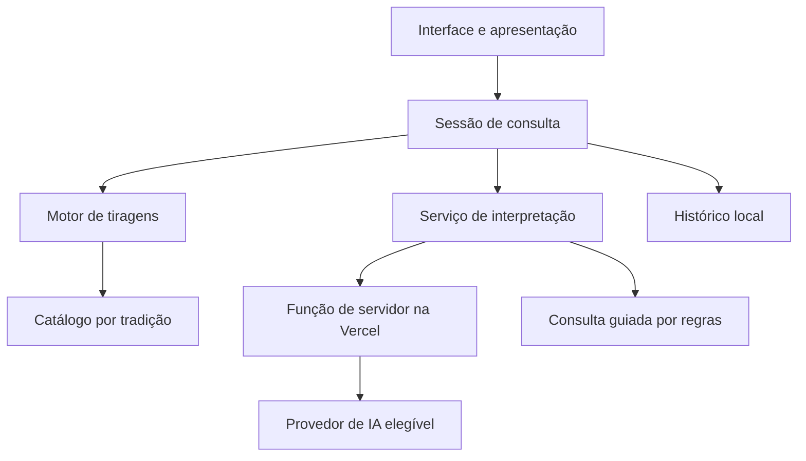

<p align="center"></p>

# Velumbra

Aplicação web interativa de cartomancia, planejada como um monólito modular full stack com interface animada, catálogo de quatro tradições, motor de tiragens e interpretação contextual opcional por IA.

O nome reúne véu, vela e *umbra* (sombra). A apresentação da experiência, ambientação, personagem e mecânicas está em [GAME.md](GAME.md).

---

## Estado e escopo do repositório

**Produção: prólogo 0.0.3. Desenvolvimento: sprint 1 em execução, com a fundação Next.js proposta para revisão.** Já existem abertura animada, cenário e velha animados em baixa resolução, identificação pela mesa, prévias dos quatro baralhos e ajustes de som e movimento. O motor de tiragens, o catálogo completo, as animações de manipulação de cartas e a IA continuam planejados. Nenhuma sprint foi aceita como concluída.

O primeiro incremento da sprint 1 fornece rota e layout em Next.js App Router com TypeScript, mantendo o controlador, a animação e o áudio aprovados como módulos de compatibilidade. A velha respira, pisca e acompanha os grunhidos sem palavras com movimentos da cabeça e da boca. O cenário tem velas, cortina, fumaça e névoa em movimento. A interface preserva fonte própria, bordô e identificação pela mesa. O registro histórico do prólogo está em [docs/PROLOGUE.md](docs/PROLOGUE.md) e o estado atual em [docs/PROGRESS.md](docs/PROGRESS.md).

**[Abrir o prólogo publicado na Vercel](https://velumbra-hazel.vercel.app/)**

O desenvolvimento está organizado em **20 sprints**: testes e mudanças nas sprints **18 e 20**, MVP integrado na sprint **19**. Em 01/11/2026 o proprietário solicitou Issues e Kanban no GitHub. O [planejamento do quadro](docs/KANBAN.md) registra a transição, dependências e pendências de acesso, preservando as 20 entregas existentes.

Em 29/10/2026, foi autorizado o ciclo de PR diário e revisão conjunta no fim de semana. O PR dessa data contém manutenção do prólogo; a progressão das sprints começa em 30/10. Alterações diárias aguardam revisão antes de merge e publicação. Resultados, limites e próximas ações estão em [docs/PROGRESS.md](docs/PROGRESS.md).

---

## Objetivos técnicos

| Objetivo | Abordagem planejada |
| --- | --- |
| Um único deploy | Interface, recursos e função de interpretação na Vercel. |
| Quatro tradições independentes | Catálogo e regras próprios para Rider–Waite–Smith, Marselha, Thoth e Petit Lenormand. |
| Leitura contextual | Combinar pergunta, intenção, tradição, posições, orientação e relações entre cartas. |
| Experiência resiliente | Oferecer consultas guiadas quando a IA estiver indisponível. |
| Custo inicial zero | Operar dentro das cotas gratuitas, sem cobrança ou recarga automática. |
| Persistência simples | Histórico no navegador, sem conta obrigatória ou banco inicial. |
| Qualidade visual | Recursos originais, animações controladas e interface responsiva. |

---

## Stack planejada

| Camada | Tecnologia ou decisão |
| --- | --- |
| Aplicação | Next.js 16.4.3, React 19.3.1 e TypeScript 7.0.2, fixados no lockfile neste incremento da sprint 1. |
| Renderização | Cena em perspectiva e personagem em camadas; técnica validada nas sprints 2 e 3. |
| Conteúdo | Dados editoriais versionados e recursos estáticos. |
| Backend | Função de servidor da aplicação, hospedada na Vercel. |
| IA | Avaliar Vercel AI Gateway gratuito; Groq Free como alternativa de integração. |
| Histórico | Armazenamento local no navegador, com validação e versão do esquema. |
| Publicação | Vercel, respeitando as condições do plano e limites de uso. |

---

## Arquitetura



A interface apresenta os resultados e controla animações. O domínio define sorteio e tiragens. A interpretação recebe os dados de domínio e a pergunta. O provedor de IA fica isolado atrás da função de servidor, permitindo trocar a integração sem reescrever a interface.

---

## Módulos e responsabilidades

| Módulo | Responsabilidade |
| --- | --- |
| Catálogo | Cartas, identidade, ordem, nomes, símbolos, fontes e arquivos de arte. |
| Tiragens | Definição de posições, sorteio sem reposição e política de inversões. |
| Consulta | Pergunta, tema, intenção, cartas e estado da jornada. |
| Interpretação | Contexto editorial, chamada opcional de IA, validação e reserva guiada. |
| Personagem | Diálogo, expressões, gestos e sincronização com as cartas. |
| Biblioteca | Inspeção completa, ampliação e descrição das cartas. |
| Diário | Persistência local, versão de esquema e recuperação de consultas. |
| Preferências | Áudio, velocidade do texto, tratamento e redução de movimento. |

---

## Modelo de conteúdo

| Entidade | Dados principais |
| --- | --- |
| Baralho | Identificador de tradição, nome, quantidade, ordem e regras. |
| Carta | ID estável, nome, número, naipe/corte quando aplicável, símbolos, descrição, arte e fonte editorial. |
| Tiragem | Identificador, posições nomeadas e quantidade de cartas. |
| Consulta | Baralho, pergunta, intenção, cartas, posições, orientação e data. |
| Leitura | Explicações por carta, conexões, veredito, modalidade e versão editorial. |

O escopo previsto é de **270 cartas**: três catálogos de 78 cartas e um de 36. Hoje o código tipa a estrutura dos quatro sistemas e mantém três amostras de cada um; ainda não contém os 270 registros. A equivalência entre cartas de tradições diferentes deve ser explícita; os sistemas não compartilham automaticamente os mesmos significados ou numeração.

---

## Fluxo de interpretação

| Etapa | Comportamento planejado |
| --- | --- |
| Entrada | Validar pergunta, tradição, tiragem e tamanho dos dados. |
| Sorteio | Selecionar cartas sem reposição, independentemente da pergunta. |
| Contexto | Reunir apenas conteúdo relevante às cartas e posições selecionadas. |
| Geração | Uma chamada retorna explicações e veredito da consulta completa. |
| Validação | Conferir formato, IDs, posições e presença das partes esperadas. |
| Apresentação | Revelar e apresentar o conteúdo progressivamente com a personagem. |
| Indisponibilidade | Oferecer consulta guiada; informar quando perguntas livres dependem de IA. |

Checagens de estrutura não asseguram qualidade semântica. Consultas de referência serão revisadas para verificar pertinência, contradições e coerência do veredito.

---

## Contrato de API proposto

A sprint 6 definirá a rota e os tipos finais. Ainda não existe endpoint implementado.

| Operação | Entrada | Saída |
| --- | --- | --- |
| Interpretar consulta | Tradição, pergunta, tiragem, IDs e orientação das cartas. | Falas por posição, conexões e veredito estruturado. |
| Tratar falha | Timeout, limite do provedor ou resposta inválida. | Estado de indisponibilidade ou oferta de modalidade guiada. |

As descrições editoriais serão resolvidas no servidor pelos IDs recebidos. O navegador não deve escolher prompts de sistema nem expor credenciais.

---

## Segurança e privacidade

| Área | Decisão planejada |
| --- | --- |
| Credenciais | Variáveis de ambiente exclusivas do servidor; nunca publicar chaves. |
| Requisições | Validar tamanho, formato, IDs de cartas e combinações permitidas. |
| Abuso e cotas | Limites de frequência, duração e saída aplicados no servidor. |
| Texto gerado | Renderizar como texto seguro; não executar HTML retornado pelo modelo. |
| Perguntas pessoais | Evitar registro do conteúdo em logs; documentar envio ao provedor quando houver IA. |
| Histórico | Permanecer no dispositivo nesta versão; sem sincronização prometida. |
| Custos | Sem recarga automática, contratação ou fallback pago. |

---

## Desenvolvimento local

Pré-requisito: Node.js da linha 24, versão 24.15 ou superior. Verificado com 24.19.0. Instale as versões do lockfile; nenhuma credencial é necessária nesta etapa.

```sh
npm ci
npm run dev
```

Abra `http://127.0.0.1:4173`. Para validar a aplicação e servir o build local:

```sh
npm run build
npm run check
npm test
npm start
```

O build fica em `.next/`, servido em `127.0.0.1:4173` por `npm start`. A configuração Vercel usa Next.js, `npm ci` e `npm run build`. Antes do desenvolvimento ou build, o preparador recria somente `public/runtime/`, copia os módulos de compatibilidade e compila o catálogo tipado para JavaScript; essa pasta é gerada, ignorada no Git e não deve ser editada. Os caminhos partem da localização do script, preservando a correção de artefatos obsoletos do PR #1. Arte e fontes são servidas por `/art/`, `/fonts/`, `/audio/` e `/brand/`.

Os testes de DOM agora renderizam o mesmo componente usado pela aplicação, sem um HTML paralelo de teste. Preservam as regressões de identificação do PR #1, verificam a publicação restrita do runtime e iniciam o servidor Next.js para conferir a rota, recursos e respostas HTTP. Esse último teste requer o build prévio. jsdom e tsx são dependências apenas de desenvolvimento. Esses testes não substituem revisão visual, áudio ou animação em navegador real. O workflow executa instalação pelo lockfile, build, tipos, sintaxe e testes.

---

## Deploy e operação

A Vercel é o destino previsto para a aplicação e a função de backend. Arte e animações serão preparadas previamente; não haverá geração de imagens ou vídeos a cada consulta.

O plano Hobby é destinado a uso pessoal e não comercial. Cotas de hospedagem e IA devem ser confirmadas durante a integração. A disponibilização gratuita inicial não representa capacidade ilimitada. Monetização exige reavaliar plano e termos.

A fundação usa a integração GitHub/Vercel com preview por PR e sem variáveis de ambiente nesta etapa. O servidor é Next.js, mas o jogo ainda não possui API de interpretação. Credenciais e integração de IA serão tratadas nas sprints correspondentes. Nenhum serviço pago foi adicionado. A produção só recebe os PRs após revisão e aprovação de Pedro.

---

## Validação e testes

| Área | Verificações previstas |
| --- | --- |
| Domínio | Contagens, IDs únicos, ordem, cortes e regras por tradição. |
| Tiragens | Quantidade, ausência de repetição e orientação permitida. |
| Interpretação | Contexto em temas distintos, mesmas cartas em perguntas diferentes e veredito coerente. |
| Resiliência | Timeout, cota esgotada, resposta inválida e modalidade guiada. |
| Interface | Navegação, biblioteca, histórico, teclado e telas móveis. |
| Arte e movimento | Legibilidade, consistência, transições e redução de movimento. |
| Publicação | Build, variáveis de ambiente e jornada completa no ambiente publicado. |

Cada sprint inclui verificação proporcional. As sprints 18 e 20 concentram revisão integrada e correções.

---

## Documentação

| Arquivo | Conteúdo |
| --- | --- |
| [GAME.md](GAME.md) | Experiência, ambientação, personagem e escopo do jogo. |
| [docs/SPRINTS.md](docs/SPRINTS.md) | Plano de execução das 20 sprints e critérios de conclusão. |
| [docs/ARCHITECTURE.md](docs/ARCHITECTURE.md) | Decisões de implementação e dependências externas. |
| [docs/ART_DIRECTION.md](docs/ART_DIRECTION.md) | Direção visual e estados animados. |
| [docs/ASSETS.md](docs/ASSETS.md) | Ícone inicial, origem e instrução de geração. |
| [docs/RESEARCH.md](docs/RESEARCH.md) | Pesquisas recuperadas, fontes e limites da verificação. |
| [docs/PROLOGUE.md](docs/PROLOGUE.md) | Implementação e validação da abertura anterior à sprint 1. |
| [docs/PROGRESS.md](docs/PROGRESS.md) | Manutenções, PRs diários, validações e pendências de revisão. |

---

## Referências técnicas

| Fonte | Uso |
| --- | --- |
| [Vercel Hobby](https://vercel.com/docs/plans/hobby) | Elegibilidade e cotas de hospedagem. |
| [Vercel AI Gateway](https://vercel.com/docs/ai-gateway/pricing) | Modelos elegíveis, créditos e limites. |
| [Groq](https://console.groq.com/docs/rate-limits) | Alternativa de integração e limites. |

---

## Estrutura atual

```text
GAME.md                  Experiência e regras previstas
docs/                    Arquitetura, arte, pesquisa e sprints
public/brand/            Ícone original recuperado
public/art/              Cabana e velha; originais e revisão em pixels maiores
public/audio/            Grunhidos sintéticos sem palavras
public/fonts/            Fontes locais e respectivas licenças
app/                     Rota, layout e estrutura da cabana em TypeScript
src/                     Controlador, animação, amostras e estilos preservados
scripts/                 Preparação do runtime e geração de recursos
test/                    Regressões de DOM, empacotamento e servidor HTTP
.github/workflows/       Verificação da aplicação em PRs
vercel.json              Configuração de publicação Next.js
```

## Autoria e contribuição

Projeto de [Pedro Henrique Silva Vargas](https://github.com/PHnsilva). O ícone inicial foi gerado com a ferramenta integrada de imagens do ChatGPT; sua origem está registrada em [docs/ASSETS.md](docs/ASSETS.md).

O planejamento é mantido nos documentos deste repositório. Contribuições devem descrever o objetivo da mudança e as verificações realizadas. O pedido atual de 01/11/2026 autoriza Issues e GitHub Projects; consultar [o fluxo por MCP](docs/AGENT_WORKFLOW.md) e distinguir planejamento de configuração efetivamente salva.

## Licença

Ainda não foi escolhida uma licença para distribuição e reutilização do projeto. Nenhuma licença de código aberto é declarada para o conjunto nesta etapa. Cormorant Garamond e IBM Plex Mono têm licenças SIL OFL próprias, preservadas em `public/fonts/`.
